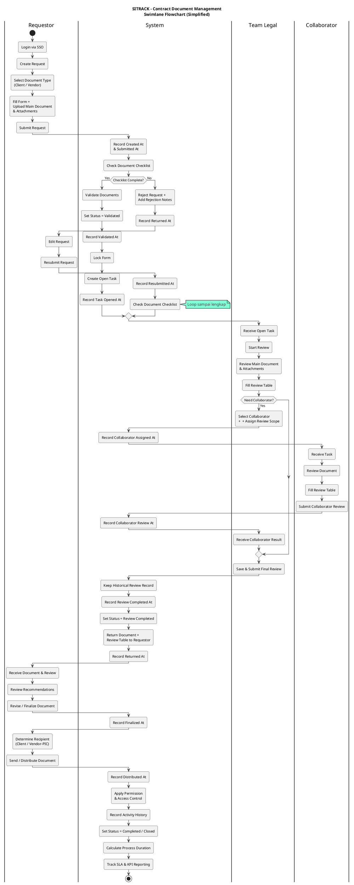

# SITARA-FE — Frontend Sistem Tracking & Review Dokumen Legal

Frontend aplikasi **SITRACK** (Sistem Manajemen & Telaah Kontrak Hukum Korporat) dibangun dengan **Vue 3 + Vite + Tailwind CSS**.

> Project ini menggabungkan tiga role (Requestor, Team Legal, dan Collaborator) menjadi satu aplikasi terpadu.

---

## Cara Menjalankan

### Prasyarat

- **Node.js** v18 atau lebih baru
- **npm** v9 atau lebih baru

### Langkah

```bash
# 1. Masuk ke folder project
cd SITARA-FE

# 2. Install dependencies (cukup sekali)
npm install

# 3. Jalankan dev server
npm run dev
```

Buka browser ke **http://localhost:5173** — otomatis redirect ke halaman `/login`.

### Perintah lainnya

| Perintah | Fungsi |
|---|---|
| `npm run dev` | Jalankan dev server (hot-reload) |
| `npm run build` | Build production bundle ke folder `dist/` |
| `npm run preview` | Preview hasil build production secara lokal |

---

## Akun Demo & Cara Login

> **Penting:** Pada sistem ini login menggunakan **SSO (Single Sign-On)** perusahaan.
> Halaman login yang tersedia adalah **simulasi SSO untuk kebutuhan demo/development saja** —
> pada production, user tidak memilih role sendiri; role ditentukan otomatis oleh SSO berdasarkan identitas karyawan.

Di halaman login, pilih role yang ingin disimulasikan, lalu klik **Masuk**:

### Requestor — Budi Santoso

| Field | Value |
|---|---|
| **Nama** | Budi Santoso |
| **Email** | `budi.santoso@sena.co.id` |
| **Role** | Requestor |
| **Divisi** | Commercial & Sales Division |
| **Password** | *(apa saja — tidak divalidasi di demo)* |

→ Setelah login, diarahkan ke `/requestor/dashboard`

---

### Team Legal — Ahmad Fauzi, S.H.

| Field | Value |
|---|---|
| **Nama** | Ahmad Fauzi, S.H. |
| **Email** | `a.fauzi@sena.co.id` |
| **Role** | Team Legal |
| **Divisi** | Senior Legal Counsel |
| **Password** | *(apa saja — tidak divalidasi di demo)* |

→ Setelah login, diarahkan ke `/legal/dashboard`

---

### Collaborator — Dimas Suryo, S.E., Ak.

| Field | Value |
|---|---|
| **Nama** | Dimas Suryo, S.E., Ak. |
| **Email** | `d.suryo@sena.co.id` |
| **Role** | Collaborator |
| **Divisi** | Tax & Finance Specialist |
| **Password** | *(apa saja — tidak divalidasi di demo)* |

→ Setelah login, diarahkan ke `/collaborator/dashboard`

---

## Bagaimana Sistem Bekerja

### Alur Bisnis (Business Process)

```
Requestor Buat Request
        │
        ▼
Phase 1 — Validasi Kelengkapan Dokumen
        │
        ├─ Dokumen Lengkap   → Open Task untuk Team Legal
        └─ Dokumen Kurang    → Dikembalikan ke Requestor untuk dilengkapi
        │
        ▼
Phase 2 — Review Dokumen oleh Team Legal
        │
        ├─ Review dilakukan Legal ± Collaborator (bila perlu)
        ├─ Catatan review per klausul (tidak dapat diubah/dihapus)
        └─ Submit Final Review
        │
        ▼
Phase 3 — Finalisasi & Distribusi
        │
        ├─ Dokumen dikembalikan ke Requestor
        └─ Requestor meneruskan ke Client / Vendor
```

### Swimlane Flowchart (Requestor - System - Team Legal - Collaborator)

Flow ini menjadi acuan hubungan tiga role: Requestor mengajukan dan memfinalisasi dokumen, System menjaga validasi/status/audit, Team Legal melakukan gatekeeping dan review utama, sedangkan Collaborator hanya mengerjakan scope yang didelegasikan. Hasil Collaborator kembali ke Team Legal sebelum final review dikirim ke Requestor.



Implementasi UI mengikuti swimlane ini melalui route dan data lintas role yang sama. Contoh end-to-end: `REQ-2026-0042` -> task legal `RVW-2026-0042-01` -> task Collaborator dengan ID yang sama. Saat Collaborator submit, hasilnya ditandai selesai dan diterima kembali oleh Team Legal pada sesi demo.

### Status Workflow

| Status | Keterangan |
|---|---|
| `DRAFT` | Request sedang disiapkan, belum disubmit |
| `SUBMITTED` | Request diajukan, menunggu validasi |
| `VALIDATING` | Sedang divalidasi kelengkapan berkas oleh Legal |
| `RETURNED` | Dikembalikan ke Requestor karena berkas kurang |
| `RESUBMITTED` | Requestor mengajukan ulang setelah melengkapi |
| `VALIDATED` | Berkas lengkap, siap masuk antrian review |
| `IN_REVIEW` | Sedang direview oleh Team Legal |
| `REVIEW_COMPLETED` | Review selesai, menunggu finalisasi |
| `RETURNED_FOR_REVISION` | Legal mengembalikan untuk revisi isi dokumen |
| `FINALIZED` | Dokumen final, siap distribusi |
| `DISTRIBUTED` | Dokumen sudah didistribusikan |
| `COMPLETED` | Proses selesai & closed |

### Role & Hak Akses

| Role | Apa yang bisa dilakukan |
|---|---|
| **Requestor** | Buat request, upload dokumen, pantau status, terima hasil review |
| **Team Legal** | Validasi kelengkapan, review dokumen, tambah collaborator, submit legal opinion |
| **Collaborator** | Menerima task dan scope terbatas, mengisi review table, lalu mengirim hasil ke Team Legal |

### Aturan Review

- Setiap baris review (klausul) yang sudah disimpan **tidak dapat diubah atau dihapus** oleh reviewer lain — termasuk sesama Team Legal dan Collaborator.
- Hasil review Collaborator tetap **ter-attribute ke nama Collaborator**, bukan ke Team Legal.
- Tombol **Submit Final Review** baru aktif jika seluruh baris review sudah diselesaikan (dan, bila ada Collaborator, hasil Collaborator sudah diterima).
- Semua aktivitas tercatat sebagai **historical record / audit trail** yang tidak dapat dihapus.

---

## Halaman yang Tersedia

### Role: Requestor

| Halaman | Route | Keterangan |
|---|---|---|
| Login (SSO mock) | `/login` | Pilih role demo & masuk |
| Dashboard | `/requestor/dashboard` | Ringkasan status request & statistik |
| Buat Request Baru | `/requestor/requests/create` | Form pengajuan + upload dokumen |
| My Requests | `/requestor/requests` | Daftar semua request + filter & search |
| Request Detail | `/requestor/requests/:id` | Workflow stepper, dokumen, matriks temuan |
| History | `/requestor/history` | Arsip request yang sudah closed |

**Contoh request yang tersedia di demo:**

| ID Request | Judul Singkat | Status |
|---|---|---|
| `REQ-2026-0042` | Draft Kontrak Pre-FEED FSRU Jawa Barat | IN_REVIEW |
| `REQ-2026-0038` | Perjanjian Sewa Lahan Terminal Maritim Cilacap | RETURNED |
| `REQ-2026-0035` | Vendor Supply Agreement — Valve & Metering | VALIDATING |
| `REQ-2026-0029` | Addendum III Kontrak Transpor Gas Subang-Cirebon | REVIEW_COMPLETED |
| `REQ-2026-0024` | Addendum Kontrak EPC Dermaga | COMPLETED |
| `REQ-2026-0021` | NDA Konsorsium Floating Storage Offshore | COMPLETED |

---

### Role: Team Legal

| Halaman | Route | Keterangan |
|---|---|---|
| Dashboard | `/legal/dashboard` | KPI, antrian validasi, tugas prioritas |
| Validation Queue | `/legal/validation` | Antrian pemeriksaan kelengkapan berkas |
| Validation Detail | `/legal/validation/:id` | Checklist dokumen, Reject / Validate |
| Review Tasks | `/legal/tasks` | Semua tugas telaah hukum (Open Tasks) |
| My Reviews | `/legal/reviews` | Tugas review saya: berjalan vs selesai |
| Review Detail | `/legal/reviews/:taskId` | Review table per klausul, Select Collaborator, Submit Final |
| History & Audit | `/legal/history` | Jejak tindakan & audit trail Tim Legal |

---

### Role: Collaborator

| Halaman | Route | Keterangan |
|---|---|---|
| Dashboard | `/collaborator/dashboard` | Ringkasan tugas aktif & SLA |
| Task List | `/collaborator/tasks` | Daftar tugas review yang diterima |
| Review Detail | `/collaborator/tasks/:taskId` | Isi review per klausul sesuai scope |
| History | `/collaborator/history` | Riwayat review yang sudah disubmit |

**Contoh task yang tersedia di demo:**
- Task Detail: `/collaborator/tasks/RVW-2026-0042-01`

**Contoh data yang bisa dibuka langsung:**
- Validation Detail: `/legal/validation/REQ-2026-0035`
- Review Detail: `/legal/reviews/RVW-2026-0042-01`

---

## Struktur Project

```
SITARA-FE/
├── index.html
├── package.json
├── vite.config.js
├── tailwind.config.js          ← Design tokens (warna, spacing, radius, font)
├── postcss.config.js
└── src/
    ├── main.js                 ← Entry point, mount Vue app
    ├── App.vue                 ← Root component (hanya <RouterView />)
    ├── style.css               ← Global styles & Tailwind directives
    ├── router/
    │   └── index.js            ← Semua routes (requestor + legal)
    ├── data/                   ← Mock data (akan diganti API)
    │   ├── users.js            ← Identitas demo 3 role
    │   ├── requests.js         ← Daftar request & detail REQ-2026-0042
    │   ├── legal.js            ← Data task, validation queue, review detail
    │   ├── collaborator.js     ← Data tugas & history collaborator
    │   └── statusConfig.js     ← Status model & Tailwind tone classes
    ├── utils/
    │   └── format.js           ← Currency (Rp) & date formatter (id-ID)
    ├── components/
    │   ├── layout/
    │   │   ├── AppLayout.vue   ← Shell: Sidebar + Topbar + slot konten
    │   │   ├── Sidebar.vue     ← Navigasi per role (requestor / legal / collaborator)
    │   │   └── Topbar.vue      ← Breadcrumb, search, notifikasi, avatar user
    │   ├── ui/
    │   │   ├── Badge.vue       ← Status badge dengan tone semantik
    │   │   ├── Button.vue      ← Tombol (primary / secondary / danger / ghost)
    │   │   ├── StatCard.vue    ← Card statistik dashboard
    │   │   └── Modal.vue       ← Dialog modal reusable
    │   └── request/
    │       └── WorkflowTimeline.vue  ← Stepper alur workflow request
    └── pages/
        ├── requestor/
        │   ├── Login.vue       ← Login + role switcher 3 role (demo only)
        │   ├── Dashboard.vue
        │   ├── CreateRequest.vue
        │   ├── RequestList.vue
        │   ├── RequestDetail.vue
        │   └── History.vue
        ├── legal/
        │   ├── Dashboard.vue
        │   ├── ValidationQueue.vue
        │   ├── ValidationDetail.vue
        │   ├── ReviewTasks.vue
        │   ├── MyReviews.vue
        │   ├── ReviewDetail.vue
        │   └── History.vue
        └── collaborator/
            ├── Dashboard.vue
            ├── TaskList.vue
            ├── ReviewDetail.vue
            └── History.vue
```

---

## Catatan Teknis

- **Semua data saat ini adalah mock** (`src/data/`). Saat backend Laravel tersedia, ganti dengan pemanggilan API sesuai pola di `DESIGN.md §89`.
- **Design tokens** (warna brand, spacing, radius, typography) dikonfigurasi di `tailwind.config.js` mengacu `DESIGN.md §7–§11`. Jangan override dengan nilai ad-hoc.
- **Status model** di `statusConfig.js` mencerminkan `DESIGN.md §63` — jangan tambah status baru di frontend tanpa koordinasi backend.
- **Ikon** menggunakan `lucide-vue-next` (akan dimigrasi ke `@lucide/vue` pada update berikutnya sesuai deprecation notice).
- **Authentication**: Login saat ini adalah mock SSO. Pada production, halaman login akan redirect ke Identity Provider (IdP) perusahaan — tidak ada form email/password manual.

---

## Roadmap

| Stage | Role | Halaman | Status |
|---|---|---|---|
| Stage 1 | Requestor | 6 halaman | ✅ Selesai |
| Stage 2 | Team Legal | 7 halaman | ✅ Selesai |
| Stage 3 | Collaborator | 4 halaman | ✅ Selesai |

---

*© 2026 SITRACK — Sistem Manajemen & Telaah Kontrak Hukum Korporat*
